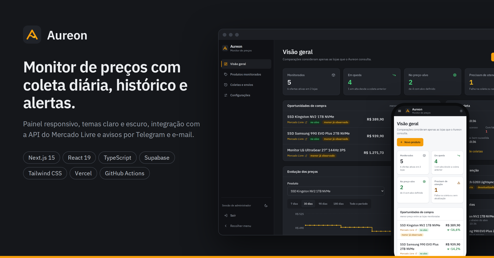
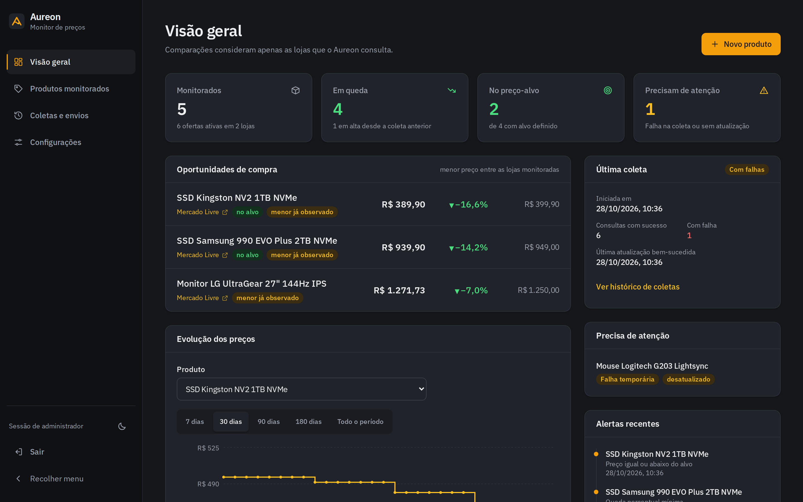
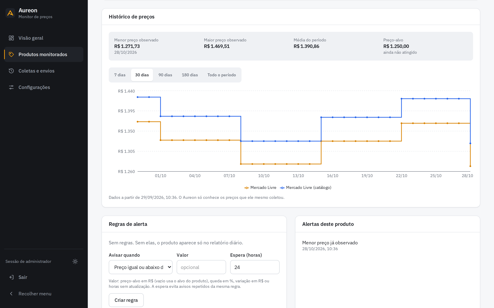
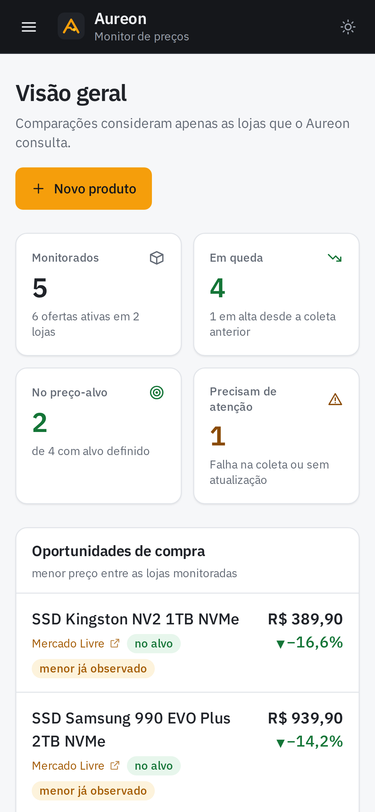
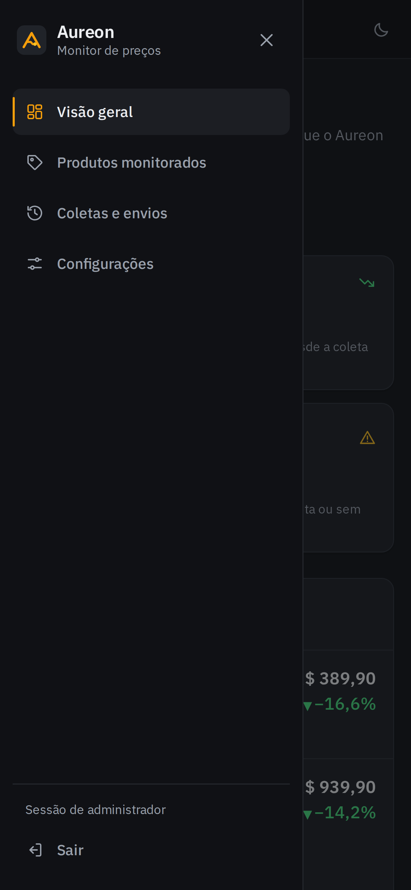
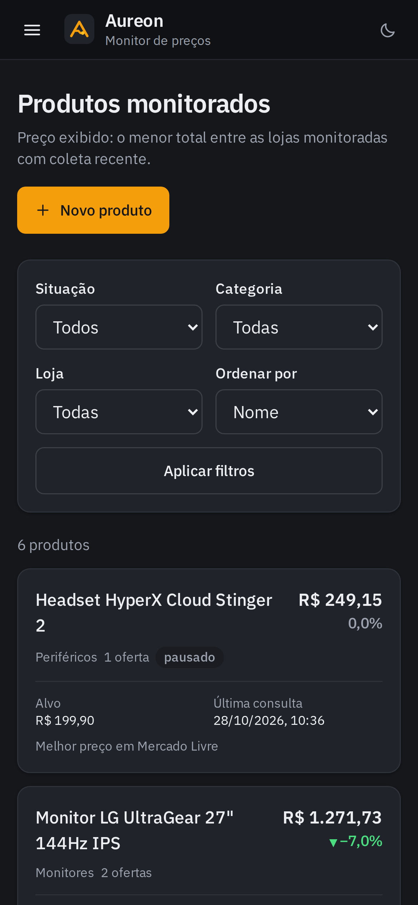

<p align="center"></p>

# Aureon



**Monitor pessoal de preços.** O Aureon consulta todos os dias os preços dos produtos que você cadastrou, guarda o histórico, compara as ofertas e avisa por Telegram, e-mail ou WhatsApp quando aparece uma oportunidade. A coleta roda na nuvem às 8h (horário de Brasília), mesmo com o seu computador desligado.

> As comparações valem só para as lojas que o Aureon consulta. O painel e os relatórios dizem “menor preço entre as lojas monitoradas”, nunca “menor preço do mercado”.

## Telas

| Visão geral (tema escuro) | Histórico de preços (tema claro) |
|---|---|
|  |  |

| Celular | Menu no celular | Produtos |
|---|---|---|
|  |  |  |

Mais capturas em [`docs/prints`](docs/prints/LEIA-ME.md). Os dados das imagens são de demonstração.

## Funcionalidades implementadas

- **Painel web** protegido por senha, responsivo (do celular de 320 px ao monitor grande), com tema claro, escuro ou do sistema:
  - **Visão geral:** produtos monitorados, ofertas em queda, produtos no preço-alvo, itens que precisam de atenção, última coleta, oportunidades de compra, gráfico de evolução e alertas recentes.
  - **Produtos monitorados:** lista com filtros (situação, categoria, loja) e ordenação; cadastro, edição, pausa, arquivamento e exclusão.
  - **Página do produto:** várias ofertas por produto com preço, frete, total estimado, variação, menor preço observado e situação da coleta; botão “Consultar agora”; gráfico de 7, 30, 90, 180 dias ou do período todo; regras de alerta.
  - **Coletas e envios:** cada execução e cada notificação registradas, com o motivo das falhas.
  - **Configurações:** canais de notificação, o que enviar, credenciais detectadas, mensagens de teste e categorias.
- **Fonte de preços:** API oficial do Mercado Livre (anúncios e páginas de catálogo), com OAuth renovado automaticamente.
- **Coleta diária** pelo GitHub Actions, com trava contra execução duplicada, repetição limitada, timeouts e limite de taxa. Uma falha nunca vira preço nem apaga o último preço válido.
- **Regras de alerta por produto:** preço-alvo, queda percentual, menor preço já observado, variação em R$, volta ao estoque e dados desatualizados, com deduplicação e período de espera.
- **Relatório diário** por e-mail, Telegram e WhatsApp (opcional), no máximo uma vez por dia por canal.

## Tecnologias

Next.js 15 (App Router), React 19, TypeScript (modo estrito), Tailwind CSS 4, Supabase (PostgreSQL), Zod, Recharts, Vitest e ESLint. Automação com GitHub Actions; envios com Telegram Bot API, Resend e WhatsApp Cloud API.

## Pré-requisitos

- Node.js **22.9 ou mais novo, na linha 22** (há um `.nvmrc`).
- Contas: GitHub, Supabase, Vercel e desenvolvedor do Mercado Livre.
- Telegram e/ou Resend para receber avisos. WhatsApp é opcional e pago.

## Instalação rápida

```bash
git clone https://github.com/SEU_USUARIO/aureon.git
cd aureon
npm ci
cp .env.example .env.local     # preencha (veja o guia de instalação)
npm run env:check              # mostra o que falta, sem exibir valores
npm run dev                    # http://localhost:3000
```

Sem o Supabase configurado, o painel abre e mostra “Falta conectar o banco de dados”. A configuração completa (banco, Mercado Livre, Telegram, e-mail) está no **[guia de instalação](docs/01-instalacao-e-configuracao.md)**.

## Comandos

| Comando | O que faz |
|---|---|
| `npm run dev` | Painel em desenvolvimento |
| `npm run build` / `npm start` | Build de produção / rodar o build |
| `npm run typecheck` | Verificação de tipos |
| `npm run lint` | ESLint |
| `npm test` | Testes unitários (sem rede e sem banco) |
| `npm run check` | Tipos + lint + testes + build |
| `npm run job:daily` | Coleta + alertas + relatório (como o agendamento) |
| `npm run job:collect` / `job:report` / `job:test-notify` | Só coleta / só alertas e relatório / mensagem de teste |
| `npm run ml:auth` | Autorizar o Mercado Livre |
| `npm run env:check` | Conferir variáveis de ambiente |
| `npm run test:integration` | Teste com Supabase **local** (exige Docker) |

## Testes

```bash
npm run check
```

São 118 testes unitários cobrindo dinheiro e datas, cálculos de preço, coletor do Mercado Livre com respostas simuladas, OAuth, rotina de coleta, regras de alerta, relatórios, envios, sessão, redação de segredos, validação, proteção contra SSRF, preferências de interface, números da Visão geral e identidade visual. O teste de integração com banco real está descrito no [guia de instalação](docs/01-instalacao-e-configuracao.md#testes).

## Implantação

- **Painel:** Vercel. Não precisa de `vercel.json`.
- **Coleta diária:** GitHub Actions (`.github/workflows/coleta-diaria.yml`), que não depende de um servidor ligado.

O passo a passo, com variáveis, callback do Mercado Livre, logs e rollback, está no **[guia de publicação](docs/05-publicacao-na-vercel.md)**.

## ⚠️ Credenciais

- **Nunca** versione o `.env.local` (ele já está no `.gitignore`).
- `SUPABASE_SERVICE_ROLE_KEY` dá acesso total ao banco. Ela fica só no servidor (Vercel) e nos Secrets do GitHub. Nenhuma variável usa o prefixo `NEXT_PUBLIC_`, então nada chega ao navegador.
- `SESSION_SECRET` precisa ter 32+ caracteres; trocá-lo encerra todas as sessões.
- Se uma chave vazar, rotacione: Supabase (nova chave em API Keys), Mercado Livre (nova Secret Key + `npm run ml:auth`), Telegram (`/revoke` no @BotFather), Resend (apague e crie a chave), Meta (novo token).

## Segurança (resumo)

Login com cookie `httpOnly` assinado (HMAC-SHA256) e limite de tentativas; toda Server Action confere a sessão além do middleware; nenhum endpoint público dispara coletas ou envios; só URLs `https` do Mercado Livre são aceitas e o sistema nunca acessa a URL informada (anti-SSRF); logs com redação automática de tokens; RLS ativo sem políticas públicas; cabeçalhos `X-Frame-Options`, `nosniff`, `Referrer-Policy`, `Permissions-Policy`, CSP parcial e HSTS; GitHub Actions com permissão só de leitura. Detalhes e limitações em [Arquitetura](docs/02-arquitetura.md#decisões-de-arquitetura-registradas).

## Documentação e material de estudo

| Documento | Para quê |
|---|---|
| [1. Instalação e configuração](docs/01-instalacao-e-configuracao.md) | Do zero até rodar localmente, variável por variável |
| [2. Arquitetura e pastas](docs/02-arquitetura.md) | Como o projeto se organiza e as decisões tomadas |
| [3. Guia de leitura do código](docs/03-guia-de-leitura-do-codigo.md) | Os arquivos importantes, explicados com trechos reais |
| [4. Fluxos completos](docs/04-fluxos.md) | Do clique ao banco: cadastro, coleta, alertas, relatório |
| [5. Publicação na Vercel](docs/05-publicacao-na-vercel.md) | Deploy, variáveis, agendamento, logs e rollback |
| [6. Glossário](docs/06-glossario.md) | Conceitos explicados com exemplos do Aureon |
| [7. Roteiro de estudos](docs/07-roteiro-de-estudos.md) | Etapas, perguntas e exercícios práticos |
| [Coletor do Mercado Livre](docs/coletor-mercado-livre.md) | Formatos de URL, campos usados e limites da API |
| [WhatsApp](docs/whatsapp.md) | Configuração opcional da WhatsApp Cloud API |
| [Relatório da reformulação Aureon](docs/RELATORIO-AUREON.md) | O que mudou, testes executados e pendências |

## Adicionar uma nova loja

1. Confirme que a loja tem API oficial ou feed de afiliados. Respeite os termos de uso; não contorne CAPTCHA nem proteção anti-robô.
2. Crie `src/lib/collectors/<loja>.ts` implementando `Collector` (`extractId` + `collect`), sempre devolvendo um `CollectorResult` com um dos status definidos.
3. Registre em `src/lib/collectors/registry.ts`, inclua o tipo em `SOURCE_TYPES` (`src/lib/types.ts`) e o domínio em `src/lib/url-allowlist.ts`.
4. Escreva testes com respostas simuladas, como em `tests/mercadolivre.test.ts`.

## Limitações conhecidas

- Uma fonte integrada (Mercado Livre). Kabum, Pichau, Terabyte, Amazon e Magalu não oferecem API pública de preços.
- O preço é o retornado pela API (pode ser promocional). Cupons, cashback e preço no Pix não são identificados.
- O frete só é calculado com `ML_ZIP_CODE` e quando não é grátis.
- Páginas de catálogo seguem a oferta vencedora, cujo vendedor pode mudar.
- O histórico começa na instalação; não há dados anteriores.
- O limite de tentativas de login fica em memória, por instância do servidor.
- O GitHub Actions pode atrasar o início do agendamento.
- O WhatsApp depende de aprovação e cobrança da Meta.

## Custos

Para uso pessoal com Telegram e e-mail, a referência é **R$ 0/mês** nos planos gratuitos de GitHub, Supabase, Vercel (Hobby, uso não comercial), Telegram e Resend. O WhatsApp é cobrado por mensagem de modelo. Os planos mudam: confira as páginas oficiais antes de depender deles.
