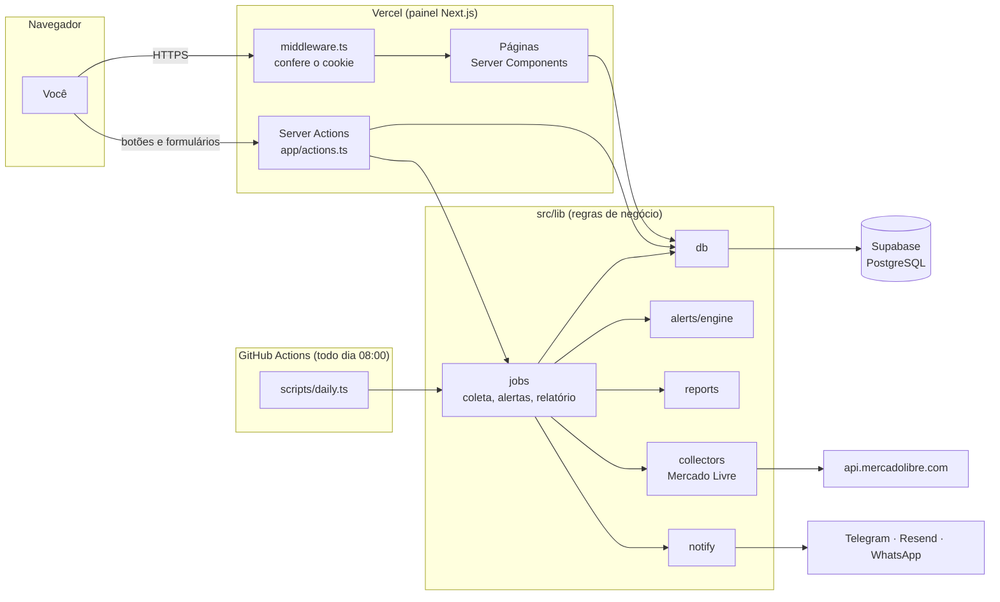

# 2. Arquitetura e estrutura de pastas

## A ideia geral em uma frase

O Aureon tem **duas portas de entrada** que usam o mesmo código de negócio: o **painel web** (Next.js, hospedado na Vercel), onde você cadastra e consulta, e a **rotina diária** (um script Node rodado pelo GitHub Actions), que coleta preços, dispara alertas e manda o relatório. Os dois falam com o mesmo banco (Supabase).



Repare em duas coisas:

1. **O navegador nunca fala direto com o Supabase.** Toda leitura e escrita passa pelo servidor, que usa a chave secreta. Por isso o banco pode ter RLS fechado para o público.
2. **A coleta diária não roda na Vercel.** Ela roda no GitHub Actions, onde um script pode demorar o quanto precisar. A Vercel só executa funções sob demanda, com limite de tempo. Mais sobre isso no [guia da Vercel](05-publicacao-na-vercel.md).

## Mapa das pastas

```
aureon/
├── .github/workflows/   ← automações do GitHub (CI e coleta diária)
├── docs/                ← esta documentação
├── scripts/             ← comandos de terminal (npm run job:*, ml:auth, env:check)
├── src/
│   ├── app/             ← páginas e rotas do Next.js (App Router)
│   ├── components/      ← peças de interface reutilizáveis
│   ├── lib/             ← regras de negócio, banco, integrações
│   └── middleware.ts    ← porteiro: bloqueia quem não fez login
├── supabase/migrations/ ← SQL que cria o banco
├── tests/               ← testes automatizados (Vitest)
├── .env.example         ← modelo das variáveis de ambiente
├── next.config.ts       ← configuração do Next (cabeçalhos de segurança)
└── package.json         ← dependências e comandos npm
```

### `src/app/` (as páginas)

**O que guarda:** cada pasta vira uma rota. No App Router do Next.js, o arquivo `page.tsx` dentro de `produtos/` responde em `/produtos`. É parecido com ter `produtos.php` na raiz do Apache, só que organizado por pastas.

**Detalhes da organização:**

- `(painel)/` está entre parênteses: é um **grupo de rotas**. O nome não aparece na URL (`/produtos`, e não `/painel/produtos`); serve só para que todas essas páginas compartilhem o mesmo `layout.tsx`, que exige login e desenha o menu.
- `login/` e `ml-callback/` ficam **fora** do grupo, porque não podem exigir login.
- `produtos/[id]/` tem colchetes: é uma rota dinâmica. `/produtos/abc-123` chega na página com `params.id = "abc-123"`.
- `actions.ts` concentra as **Server Actions**: funções que rodam no servidor e são chamadas pelos formulários e botões.
- Arquivos especiais do Next: `layout.tsx` (moldura), `loading.tsx` (esqueleto enquanto carrega), `error.tsx` (tela de erro), `not-found.tsx` (404), `icon.svg` (favicon), `globals.css` (estilos e tema).

**Quem usa:** o navegador, via URL. **Quando mexer aqui:** para mudar o que uma página mostra ou criar uma página nova.

### `src/components/` (peças de interface)

| Arquivo | O que é |
|---|---|
| `ui.tsx` | Peças básicas: `PageHeader`, `Section`, `StatCard`, `Badge`, `Money`, `Change`, `EmptyState`, `Skeleton`, as classes de botão (`buttonClass`) e os avisos. |
| `forms.tsx` | Todos os formulários (login, produto, oferta, regra, categoria, configurações). |
| `action-buttons.tsx` | `RunAction` (botão que executa uma ação) e `ConfirmAction` (botão com diálogo de confirmação). |
| `price-chart.tsx` | O gráfico (Recharts). |
| `price-chart-lazy.tsx` | Carrega o gráfico só quando ele vai aparecer. **As páginas importam este, não o anterior.** |
| `icons.tsx` | Ícones SVG e a marca do Aureon. |
| `use-media-query.ts` | Hook que avisa se a tela é estreita (usado pelo gráfico). |
| `layout/app-shell.tsx` | A moldura do painel: menu lateral, barra do celular e gaveta. |
| `layout/nav-list.tsx` | A lista de links do menu (a mesma no desktop e na gaveta). |
| `layout/theme-toggle.tsx` | O botão de tema claro/escuro/sistema. |

**Por que separado de `app/`:** a mesma peça aparece em várias páginas. Se o botão primário mudar de cor, muda em um lugar só.

### `src/lib/` (o cérebro)

Aqui fica tudo que **não é interface**. Quase todo arquivo é TypeScript puro e testável sem navegador.

| Pasta/arquivo | Responsabilidade |
|---|---|
| `types.ts` | Os tipos do domínio (`Product`, `PriceRecord`...) e os rótulos em português dos status e regras. |
| `env.ts` | Lê e valida as variáveis de ambiente. |
| `brand.ts` | Nome e descrição do Aureon. |
| `ui-prefs.ts` | Cookies de tema e de menu recolhido. |
| `money.ts`, `dates.ts` | Converter/formatar reais e datas (sempre no fuso de Brasília). |
| `analytics.ts` | Cálculos: variação, mínimo, máximo, média, preço-alvo, desatualização. |
| `dashboard.ts` | Os números da Visão geral. |
| `validation.ts` | Esquemas Zod dos formulários. |
| `url-allowlist.ts` | Quais domínios de loja são aceitos (proteção contra SSRF). |
| `logger.ts` | Log em JSON que apaga tokens automaticamente. |
| `rate-limit.ts` | Limite de tentativas (login, “Consultar agora”, testes de envio). |
| `auth/` | Sessão: criar e conferir o cookie assinado; `guard.ts` com `requireAdmin()`. |
| `db/` | Acesso ao Supabase. `client.ts` cria a conexão; `queries.ts` tem as consultas do painel; `repository.ts` define o **contrato** usado pelas rotinas; `supabase-repository.ts` implementa esse contrato. |
| `collectors/` | Buscar preço numa loja. Hoje só o Mercado Livre (`mercadolivre.ts`, `mercadolivre-auth.ts`), mais o cliente HTTP com timeout e repetição (`http.ts`) e o registro de coletores (`registry.ts`). |
| `jobs/` | As rotinas: `collect.ts` (coleta), `alerts.ts` (alertas), `report.ts` (relatório), `context.ts` (monta as dependências reais). |
| `alerts/engine.ts` | Decide **se** um alerta deve disparar. Função pura. |
| `reports/` | `build.ts` monta os dados do relatório; `render.ts` transforma em e-mail, Telegram e WhatsApp. |
| `notify/` | Envia mensagens (Telegram, Resend, WhatsApp) e registra cada envio, sem duplicar. |

### Por que existe o tal “repositório”?

`db/repository.ts` é uma **interface**: uma lista de funções (`startRun`, `insertPrice`, `listActiveRules`...) sem implementação. As rotinas em `jobs/` só conhecem essa interface. Em produção, quem a implementa é `supabase-repository.ts`; nos testes, é `tests/helpers/memory-repository.ts`, que guarda tudo em arrays na memória.

Resultado: dá para testar a coleta inteira, com falha de loja, trava diária e preservação do último preço, sem banco nenhum. Em PHP, é o mesmo padrão de quem cria uma `interface ProdutoRepository` e duas classes que a implementam.

As páginas do painel não usam o repositório; usam `db/queries.ts`, que tem consultas mais ricas (com os produtos já “montados” para exibição, em `ProductView`).

### `scripts/`

Comandos de terminal, rodados com `tsx` (que executa TypeScript direto, sem compilar antes):

- `daily.ts`: a rotina diária. Aceita `--skip-collect`, `--skip-alerts`, `--skip-report`, `--test-notify`, `--dry-run`, `--force` e `--trigger=`.
- `ml-auth.ts`: autorização do Mercado Livre.
- `check-env.ts`: confere as variáveis.

### `.github/workflows/`

- `ci.yml` (“Verificação”): a cada push ou pull request, roda tipos, lint, testes, build e `npm audit` das dependências de produção.
- `coleta-diaria.yml`: todo dia às 11:00 UTC (08:00 em Brasília) roda `scripts/daily.ts`. Também pode ser disparado à mão, com modos e opções.

### `supabase/migrations/`

O SQL que cria tabelas, índices, restrições e RLS. **Não edite um arquivo de migração já aplicado.** Para mudar o banco, crie um arquivo novo com data mais recente. É por isso que o comentário do topo do arquivo ainda diz “Monitor de Preços”: ele é histórico.

### `tests/`

Testes Vitest. `helpers/` tem o repositório em memória e o stub de `server-only`. `integration/` tem o teste com banco real local.

## Onde procurar quando quiser mudar…

| Quero mudar… | Vá em… |
|---|---|
| Cores, tema, fonte | `src/app/globals.css` (tokens no topo) |
| Nome/descrição do app | `src/lib/brand.ts` |
| Itens do menu | `src/components/layout/nav-list.tsx` (`NAV_ITEMS`) |
| Os cards da Visão geral | `src/app/(painel)/page.tsx` + cálculos em `src/lib/dashboard.ts` |
| Um campo do cadastro de produto | `forms.tsx` (`ProductForm`) + `validation.ts` (`ProductInput`) + `actions.ts` (`saveProduct`) + uma **migração nova** se for coluna nova |
| Texto do e-mail/Telegram | `src/lib/reports/render.ts` |
| Uma regra de alerta | `src/lib/alerts/engine.ts` + `RULE_TYPES`/`RULE_LABELS` em `types.ts` + restrição no SQL |
| Horário da coleta | `.github/workflows/coleta-diaria.yml` (o `cron`) + o texto em `configuracoes/page.tsx` e `forms.tsx` |
| Adicionar uma loja | `collectors/` + `registry.ts` + `SOURCE_TYPES` + `url-allowlist.ts` (veja o README) |
| Cabeçalhos de segurança | `next.config.ts` |

## Decisões de arquitetura registradas

**Server Components por padrão.** As páginas buscam dados no servidor e mandam HTML pronto. Só viram Client Component (`"use client"`) as peças que precisam de estado ou eventos: formulários, botões de ação, gráfico, menu e tema.

**Server Actions em vez de rotas de API.** Não existe pasta `app/api/`. Os formulários chamam funções de `actions.ts` direto. Cada uma chama `requireAdmin()` antes de tudo, além da checagem do middleware (defesa em profundidade). Não há endpoint público que dispare coleta ou envio.

**Preferências de interface em cookie.** O tema e o menu recolhido ficam em cookies que o servidor lê antes de gerar o HTML. Com `localStorage`, a página nasceria clara e piscaria para escuro depois que o JavaScript carregasse.

**Gráfico carregado sob demanda.** O Recharts pesa uns 100 kB. Com `next/dynamic`, ele só é baixado nas páginas que mostram gráfico. O JavaScript inicial da Visão geral caiu de 211 kB para 109 kB.

**Coleta no GitHub Actions, não no Vercel Cron.** Já estava implementada assim e funciona bem. Detalhes da avaliação no [guia da Vercel](05-publicacao-na-vercel.md#rotinas-agendadas).

**CSP parcial.** O `next.config.ts` envia uma Content-Security-Policy que bloqueia o painel dentro de iframes (`frame-ancestors 'none'`), plugins, troca da tag `<base>` e envio de formulários para outros sites. Ela **não** restringe scripts: o Next injeta scripts inline, e uma política de scripts exigiria um *nonce* por requisição e muito cuidado. Fica como melhoria futura.

**Ícones próprios.** O projeto não tinha biblioteca de ícones. Como são só ~20, foram desenhados em `icons.tsx` em vez de adicionar uma dependência.

**Erros com detalhe para o administrador.** `ErrorNotice` mostra a mensagem do banco (já sem segredos, via `errorMessage`). Como o painel é privado e de uma pessoa só, ajuda mais do que atrapalha. O `error.tsx` global não mostra detalhes, só o código para procurar nos logs.
