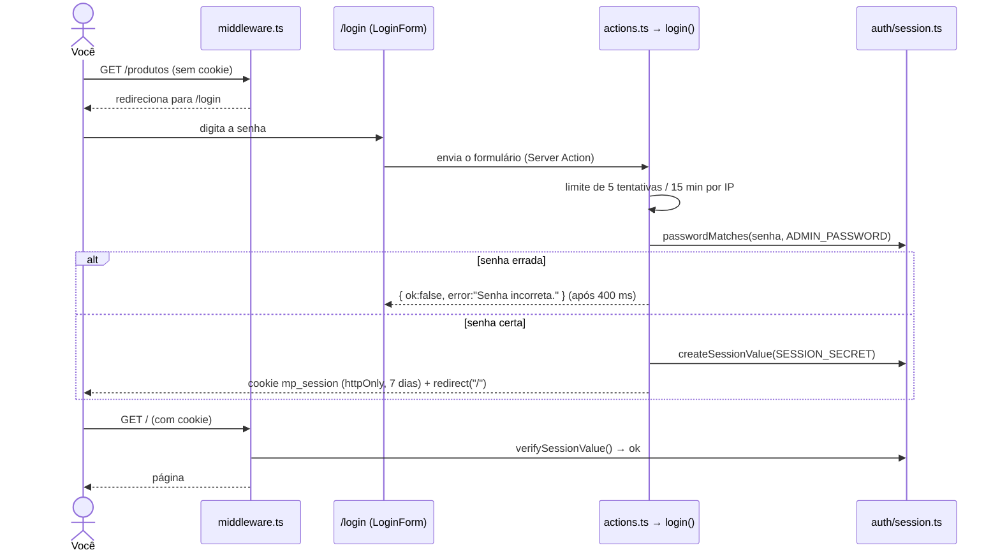
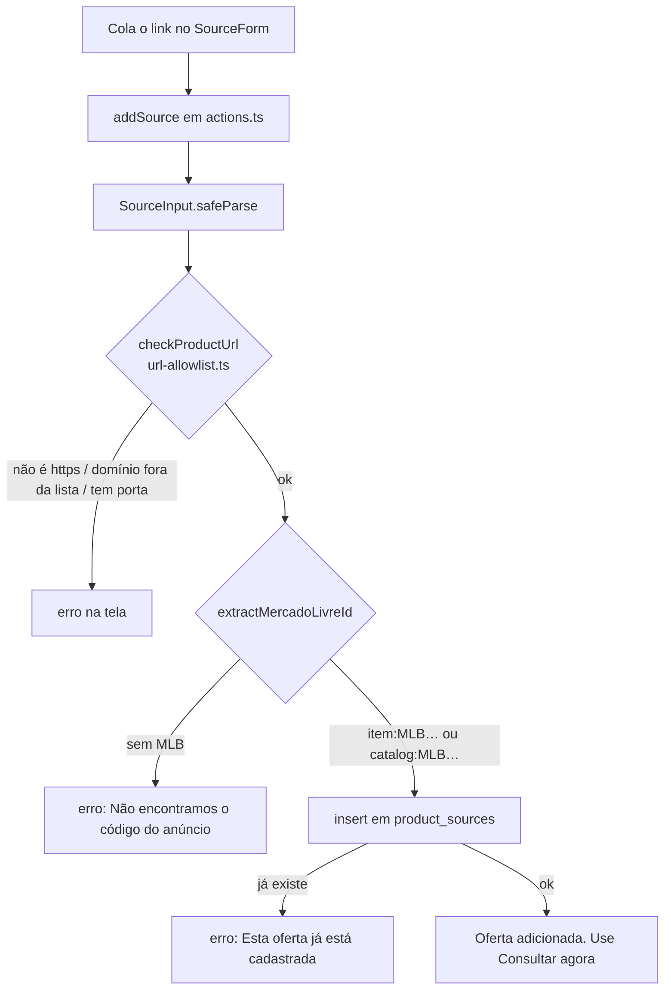
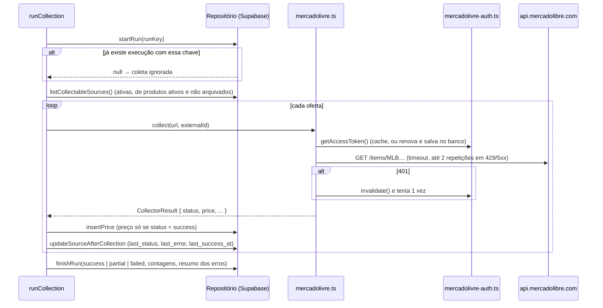
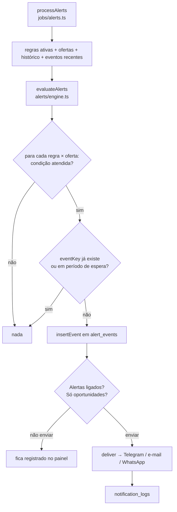
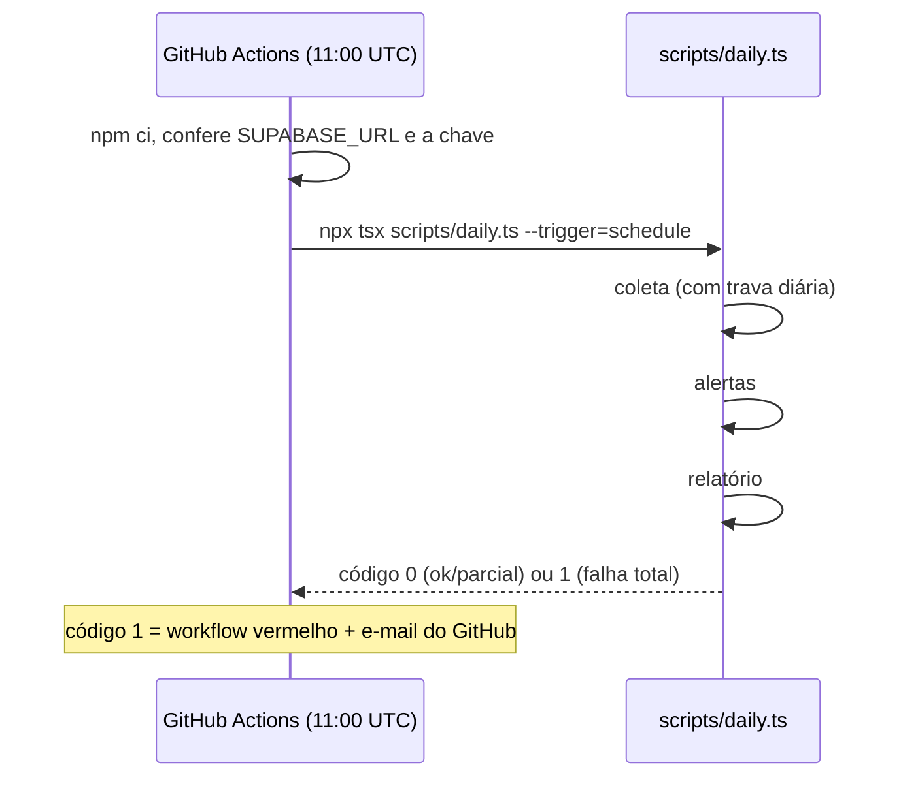

# 4. Fluxos completos de funcionamento

Aqui seguimos um dado do começo ao fim. Cada fluxo diz quais arquivos participam, na ordem. Todos os fluxos abaixo estão implementados; o que não está aparece na última seção.

## 1. Autenticação no painel

O cookie se chama `mp_session` (sobra do nome antigo). Ele **não** foi renomeado de propósito: trocar o nome deslogaria todo mundo e não traz nenhum ganho.

O “Sair” (`logout`) apaga o cookie e redireciona para `/login`.

## 2. Cadastro de produto

1. `/produtos/novo` → `ProductForm` (`forms.tsx`).
2. O formulário chama `saveProduct` (`actions.ts`). O botão fica desabilitado enquanto envia.
3. `requireAdmin()` → `ProductInput.safeParse()` (`validation.ts`): nome com 2 a 160 caracteres, preços em reais válidos (`parseBRL` aceita “1.299,90”), alvo ≤ máximo, categoria UUID ou vazia.
4. `insert` em `products` → `revalidatePath` → `redirect('/produtos/<id>?novo=1')`.
5. A página do produto mostra a faixa verde “Produto cadastrado. Agora adicione o link…”.

## 3. Cadastro e validação de uma oferta (URL)

O índice único `product_sources_unique_external` impede a mesma oferta duas vezes no mesmo produto. O erro `23505` do Postgres vira a mensagem amigável.

## 4. Coleta do preço

Dois gatilhos usam a **mesma** função `runCollection` (`jobs/collect.ts`):

- **“Consultar agora”** no painel: `collectSourceNow` → `runCollection({ sourceIds: [id], trigger: "panel", runKey: null })`. Limite de 1 consulta por minuto por oferta e 10 por minuto no total.
- **Agendada**: `scripts/daily.ts` → `runCollection({ trigger: "schedule", runKey: "schedule:AAAA-MM-DD" })`.

## 5. Armazenamento e histórico

Cada consulta vira **uma linha** em `price_history`, com sucesso ou falha. O banco reforça as regras com restrições:

- `price_history_success_has_price`: sucesso sem preço é recusado;
- `price_history_price_positive`: preço ≤ 0 é recusado;
- `price_history_source_run_unique`: a mesma oferta não grava duas vezes na mesma execução.

Na hora de exibir, `validPoints` (`analytics.ts`) descarta as falhas, então o gráfico e as estatísticas só usam preços reais.

## 6. Detecção de mudanças

Não existe um passo separado de “detectar mudança”: ela é **calculada na leitura**, comparando a última coleta válida com a anterior (`computeStats`):

- `pctChange` e `absChange`: variação desde a coleta válida anterior;
- `isHistoricLow`: o último preço é menor que todos os anteriores;
- `stale`: a última coleta válida é mais antiga que “Considerar desatualizado após (horas)” (padrão 48 h).

O painel usa esses números (Visão geral, lista, detalhe), e as regras de alerta também.

## 7. Disparo de alertas

| Regra | Dispara quando | É “oportunidade”? |
|---|---|---|
| Preço igual ou abaixo do alvo | preço atual ≤ valor da regra (ou o alvo do produto) | sim |
| Queda percentual mínima | queda desde a coleta anterior ≥ valor (%) | sim |
| Menor preço já observado | `isHistoricLow` | sim |
| Variação acima de um valor (R$) | \|variação\| ≥ valor | não |
| Produto disponível novamente | coleta anterior “indisponível” e atual com sucesso | sim |
| Sem atualização há muitas horas | sem sucesso há mais de N horas | não |

Com “Só oportunidades” marcado, as duas últimas não geram mensagem, mas ficam registradas.

## 8. Geração e envio do relatório

1. `sendDailyReport` (`jobs/report.ts`) → `generateDailyReport` busca produtos, histórico e a última execução.
2. `buildDailyReport` (`reports/build.ts`) separa os grupos.
3. Se “Resumo diário” estiver desligado ou não houver canal, para aqui (registrando no log).
4. `renderDailyReport` (`reports/render.ts`) gera e-mail HTML, texto, Telegram e WhatsApp.
5. `deliver` com chave `daily:AAAA-MM-DD`: no máximo um envio por dia por canal. A opção **forcar** do workflow muda a chave para permitir reenviar.

## 9. Execução automática diária

O GitHub pode atrasar o início em alguns minutos (às vezes mais em horários de pico). Pela aba **Actions**, dá para rodar à mão escolhendo o modo (`completo`, `so-coleta`, `so-alertas-e-relatorio`, `teste-de-notificacao`) e as opções `forcar` e `simulacao`.

## 10. Preferências de interface (tema e menu)

1. Clique no botão de tema → `applyTheme` muda `data-theme` no `<html>` e grava o cookie `aureon-theme`.
2. Na próxima requisição, `app/layout.tsx` lê o cookie e já gera o HTML com o tema, sem piscar.
3. O menu recolhido segue a mesma ideia, com o cookie `aureon-sidebar` lido em `(painel)/layout.tsx`.

## O que não está implementado

Para não haver dúvida sobre o que o sistema **não** faz:

- **Outras lojas além do Mercado Livre.** A estrutura está pronta (`collectors/registry.ts`), mas não há outro coletor.
- **Imagem do produto.** Não existe essa coluna no banco nem a coleta da foto; por isso a lista não mostra imagens.
- **Exportar histórico (CSV), aviso de troca de vendedor, vários usuários.** Não existem.
- **Coleta com horário garantido.** O agendamento depende do GitHub Actions, que pode atrasar.
- **Limite de tentativas de login compartilhado.** O contador fica na memória de cada instância do servidor; na Vercel, instâncias diferentes não se enxergam.
